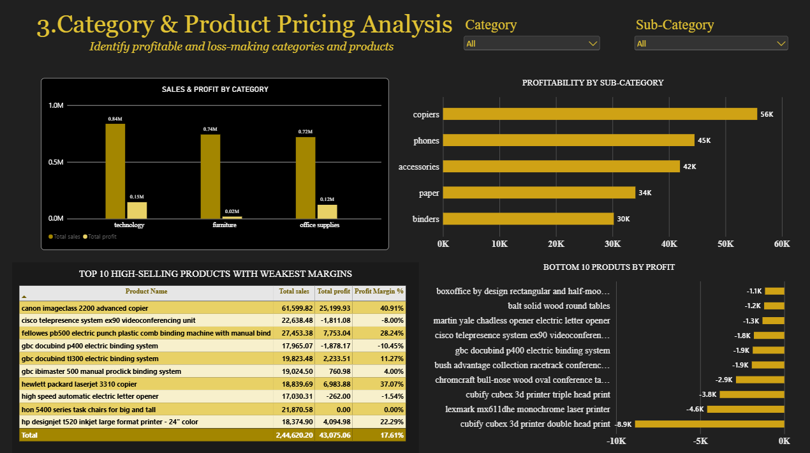
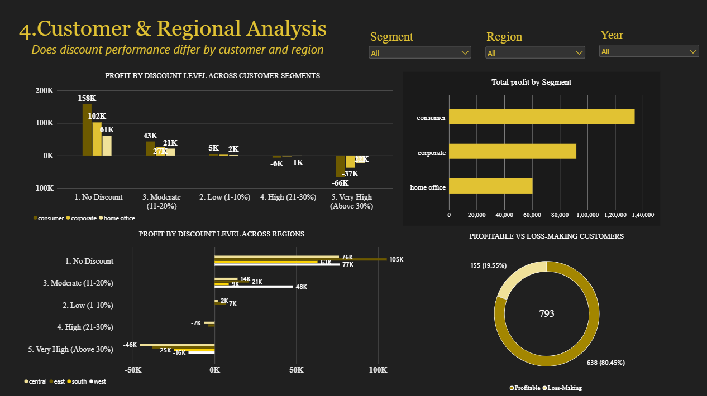

Retail Pricing and Discount Effectiveness Analysis

An end-to-end data analytics project exploring how discount strategies relate to sales performance and profitability using Python, SQL, and Power BI.

1. Project Overview

This project analyzes retail sales data to evaluate discount effectiveness and understand its relationship with business profitability.

The analysis explores product categories, customer segments, regional performance, and discount levels to identify areas where pricing strategies are performing well and where improvements may be needed.

The project combines Python-based data analysis, SQL business queries, and an interactive Power BI dashboard to transform raw sales data into actionable business insights.

2. Problem Statement

Are discounts helping the business generate profitable sales, or are they reducing profit without enough benefit?

Businesses often use discounts to encourage purchases and increase sales. However, higher sales do not always translate into higher profitability.

This project investigates discount patterns and profitability to help identify pricing strategies that deserve closer attention.

3. Dataset

- Dataset: Superstore Sales Dataset
- Records: 9,994 orders
- Geographic coverage: United States
- Period: 2014–2017

The dataset contains information about:

- Orders and order dates
- Customers and customer segments
- Product categories and subcategories
- Sales, quantity, discount, and profit
- Shipping information and regional performance
- Returns and regional personnel information

4. Tools and Technologies

Layer| Technologies
Programming Language| Python
Data Analysis| Pandas, NumPy
Data Visualization| Matplotlib
Database Querying| SQL
Dashboard Development| Power BI

5. Methods and Workflow

1. Data Understanding and Cleaning

- Inspected dataset structure and data types.
- Checked missing values and duplicate records.
- Reviewed numerical and categorical variables.
- Prepared data for analysis.

2. Exploratory Data Analysis

- Examined sales and profit distributions.
- Evaluated discount levels and profitability patterns.
- Compared category, customer, and regional performance.
- Identified unusual and loss-making patterns.

3. SQL Analysis

- Analyzed sales and profitability using SQL.
- Compared performance across product categories and subcategories.
- Evaluated discount levels and their relationship with profit.
- Examined customer and regional contributions.

4. Dashboard Development

- Developed a multi-page Power BI dashboard.
- Created business-focused KPIs and interactive visuals.
- Organized insights into clear analytical sections.
- ### Dashboard Screenshots

#### 1. Executive Pricing Overview


#### 2. Discount Impact Analysis


#### 3. Category & Product Pricing Analysis


#### 4. Customer & Regional Analysis


#### 5. Pricing Strategy & Recommendations


6. Key Insights

- Technology generated the highest sales and profit among the product categories.
- Furniture recorded significant sales but comparatively lower profitability.
- Higher discount levels were associated with weaker profitability.
- The Central region recorded the lowest profit margin at approximately 7.92%.
- The West region recorded the strongest profit margin at approximately 14.94%.
- Approximately 20% of orders were loss-making.

These findings describe observed relationships in the dataset and should not be interpreted as proof that discounts alone caused lower profits.

7. Dashboard and Outputs

The interactive Power BI dashboard contains five analytical pages:

1. Executive Pricing Overview – Overall sales, profit, and pricing performance.
2. Discount Impact Analysis – Relationship between discount levels and profitability.
3. Category & Product Pricing Analysis – Product-level and category-level performance.
4. Customer & Regional Analysis – Customer segments and regional profitability.
5. Pricing Strategy & Recommendations – Business insights and recommended pricing actions.

Dashboard screenshots and the Power BI file will be available in this repository.

8. How to Run This Project

1. Clone or download this repository.
2. Install Python and the required libraries.
3. Open the Jupyter Notebook in Jupyter or VS Code.
4. Update the dataset path if required.
5. Run the notebook cells to reproduce the analysis.
6. Open the SQL files in your SQL environment to review and execute the queries.
7. Open the Power BI file using Power BI Desktop to explore the dashboard.

Python Libraries

pip install pandas numpy matplotlib

## How to Run This Project

1. Clone this repository:
   ```bash
   git clone https://github.com/farhakounen/retail-pricing-and-discount-effectiveness-analysis.git
   ```

2. Open the Python notebook using Jupyter Notebook or VS Code.

3. Install the required Python libraries:
   ```bash
   pip install pandas numpy matplotlib seaborn
   ```

4. Open the SQL file in PostgreSQL using pgAdmin.

5. Open the Power BI dashboard using Power BI Desktop.


9. Results and Conclusion

The analysis demonstrates why sales volume alone is not sufficient to evaluate pricing performance.

Some categories and regions generate stronger profitability than others, while higher discount levels are associated with weaker profit outcomes.

The findings emphasize the importance of evaluating discount strategies alongside profitability, product performance, and customer and regional contributions.

10. Future Work

- Analyze promotion effectiveness using additional campaign-level data.
- Explore customer purchasing responses to different discount levels.
- Incorporate additional datasets to validate pricing patterns.
- Extend the dashboard with further pricing performance metrics.

11. Project Structure

The repository will contain the following files:

retail-pricing-and-discount-effectiveness-analysis/
│
├── README.md
├── Python/
│   └── retail_pricing_analysis.ipynb
├── SQL/
│   └── retail_pricing_analysis.sql
├── Dataset/
│   ├── superstore_cleaned.csv
│   └── Superstore.xls
├── Dashboard/
│   └── screenshots/
│       ├── 01_Executive_Pricing_Overview.png
│       ├── 02_Discount_Impact_Analysis.png
│       ├── 03_Category_Product_Analysis.png
│       ├── 04_Customer_Regional_Analysis.png
│       └── 05_Pricing_Strategy_Recommendations.png
├── Executive overview.pbix
└── powerbi-dashboard.md

## Project Files

### Python Analysis
[View Python Jupyter Notebook](Python/retail_pricing_analysis.ipynb)

### SQL Analysis
[View SQL Queries](SQL/retail_pricing_analysis.sql)

### Dataset
- [Download Cleaned Dataset](Dataset/superstore_cleaned.csv)
- [Download Original Dataset](Dataset/Superstore.xls)

### Power BI Dashboard
[Download Power BI Dashboard (.pbix)](Executive%20overview.pbix)
12. Author and Contact

Farha Kounen
Aspiring Data Analyst

- GitHub: "farhakounen" (https://github.com/farhakounen)
- LinkedIn: linkedin:www.linkedin.com/in/farha-kounen-9a1711420

13. Acknowledgement

This project was developed as part of my Data Analyst portfolio to demonstrate practical skills in data analysis, SQL querying, business intelligence, and data-driven decision-making.
